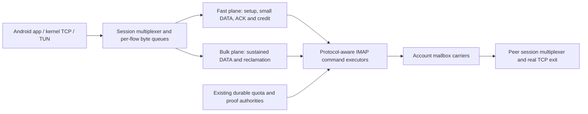

# One integrated replacement for the ITOM transport

Decision document, 24 October 2026 (Moscow). Implementation has begun on the isolated session-v2 branch; see [current implementation status](SESSION_V2_STATUS.md). This document is a contract, not a qualification result. The later user instruction replaces all owned active Go tests after the first implementation and rejects the old transport as an implementation or behavioral oracle.

The [25 October user decision](TEMPORARY_RTT_POLICY.md) temporarily sets the idle/light maximum to 300ms; 250ms remains preferred pending real-world confirmation. Historical measurements below retain their original interpretation.

## Decision and acceptance boundary

Replace the current per-account transport/stream-owner actors, socket borrowing, mailbox hot-window timers and overlapping placement/admission feedback loops with a **session-owned, two-plane message transport**. Accounts supply physically accounted mailbox service; an account no longer owns an application TCP connection. Fast messages and bulk bodies have separate persistent mailbox/command resources. A protocol-aware IMAP executor replaces whole-operation mutex scheduling. Publication is admitted against the exact remaining grant before batching and encryption.

This is one new wire/layout version, one implementation branch, one migration and one integrated candidate. The components below are parts of that replacement, not successive tuning RCs. We will not bolt a new controller onto the existing scheduling stack or ship intermediate partial rewrites.

User targets for client-to-IMAP RTT varying 10–50ms and server-to-IMAP RTT varying 20–40ms:

| Criterion | New release gate |
| --- | --- |
| Idle/light application request/reply RTT | Every measured small exchange ≤300ms (250ms preferred), including the first exchange after quiet periods |
| Application RTT during heavy transfer | Every measured probe ≤2000ms |
| Sustained useful bandwidth |≥ 100Mbps upload and≥ 100Mbps download, separately and simultaneously; SINGLE and MULTI both count |
| TLS/Speedtest completion | Zero unexpected failures, including the first run after connection |
| Connection stability | Zero load-induced IMAP socket replacements, line losses or unrelated application resets |
| Accounting/recovery | All original quota, journal, wallet, cryptographic and crash-recovery invariants preserved |

Maxima are gates. Means/p95/p99 remain useful diagnostics, but cannot hide a 300ms violation. Internal recovery/cleanup/heartbeat work cannot relabel externally idle application traffic as heavy load. The original 17/20 rule is no longer an acceptance shortcut for this rewrite. Old criteria/results remain recorded separately; the user's new 2000ms heavy-load allowance is an explicit new target, not a retroactively passing old 750/1100ms result.

## What the evidence establishes

I reread and hash-verified the89 canonical historical reports in the existing evidence inventory (5,944,091 bytes), the RC3–RC13 per-file disposition, five additional DEV9 build/result/patch records, and all four new trace bundles. This is a review of historical evidence, not a claim that every historical executable was rerun.

The new screenshots show SINGLE 19.5/45.3Mbps with 357ms idle RTT, and MULTI 40.6/27.9Mbps with 354ms idle RTT. Loaded values 618–701ms meet the new loaded ceiling in those successful screenshots; throughput and idle responsiveness do not meet the targets. The reported initial failed tests remain additional failures, not omitted speed samples.

One client ZIP also contains 36,503 events from the previous day's session. They were excluded. The current client windows are 04:32:15–04:34:36 and 04:39:12–04:41:09 Moscow; the server tails start later. Exact UTC windows and methods are in [FIELD_EVIDENCE.json](experiments/structural-rework-20261024/FIELD_EVIDENCE.json).

| New client trace | Completed control echoes | Mean / p95 / maximum |
| --- | ---: | --- |
| First run | 419|407 /709 /2307ms|
| Later Speedtest run | 351|473 /772 /2634ms|

These are sealed-PING to received-PONG intervals on the same endpoint clock, spanning mixed workload. They are not ICMP RTT or application echo samples. In observed payload-quiescent intervals, first-run 15/15 and later-run 21/23 control echoes still exceed 250ms. Those intervals do not prove all application sockets were idle. The screenshots independently demonstrate that application-level baseline RTT also remains too high.

Other material findings:

* The captures report 15 ready accounts, two phone sockets and three server sockets per account. The latest problem is not the earlier 28/30 quota-readiness failure. A ready bit does not establish usable TLS/data service.
* The later phone trace records 283 `data_batch_completion` outcomes with `WALLET_EXHAUSTED`, plus 249 sampled rollover events across 14 accounts. In this implementation these are retryable pre-APPEND outcomes, not proof of corruption/overdraw or 283 failed Speedtests. They show avoidable grant selection, fencing, descriptor and rescheduling work on the data path.
* The later server's DATA prepare stage averages 27.6ms, p95 74.8ms; completion/close averages 21.4ms. These spans are not pure disk latency measurements: they include locking/scheduling. They cannot be ignored, or added again as independent wire delay.
* Later control FETCH wrappers average 76ms on the phone and 152ms on the server; observed-delete wrappers average 140/204ms. These include local queueing and multiple protocol turns. A 20ms NOOP sample does not bound them to 20ms.
* Account cards' TCP-stream count represents logical ownership, while DATA is striped over other accounts. Zero owned streams does not mean zero physical DATA, control or cleanup work. The new diagnostics must display both.
* The retained windows do not show increasing per-account reconnect counters. Some counters are already 1 at the beginning of the later tail. `socket_write CLOSED/RESET` events with stream IDs are application/upstream socket events, not automatically IMAP reconnects. Their origin must be traced rather than guessed.
* The first trace contains 189 completed tunnel OPENs and the later 56, without retained OPEN_ERROR outcomes. OPEN_OK is not a completed TLS handshake. The exact cause of every initial Speedtest failure cannot be assigned from the rotated server tail and encrypted application data alone.

The detailed sanitized evidence preserves these limitations. Original profiles, credentials and payloads are not copied into the public plan.

## Historical conclusions that change this design

| History | Useful evidence to retain | Assumption to discard |
| --- | --- | --- |
| RC2/final1.0.0 | Immutable usable-field reference, durable authority and recovery contracts | A stable field baseline is automatically good at every synthetic latency/path |
| RC3–RC9 | Failed small-window, fixed-read-gate and batch-growth experiments | Cutting bulk flight until ping looks good is progress |
| RC10–RC13 | Independent healthy-server paths, stage profiling, exact retained-debt cases | Recovered line count or a single paired speed result proves an RTT/stability improvement |
| DEV1–DEV4 | Cold/retained comparisons and demand-versus-supply distinction | A useful-delivery model can compensate for a serialized physical command path |
| DEV5–DEV8 | Scoped cleanup, race fixes, quota/recovery proofs, recorded field failures | Long warmed high-rate tests represent first-ready Android TLS/Speedtest behavior |
| DEV9 | Exact debt readiness, bounded borrowing tests, direct DEV8 comparisons | The same whole-operation architecture becomes reliable by adding more wake windows/reserve scores |

DEV9's own published record says 18/20 broad rounds but only 4/24 captured-role phases meeting the100Mbps/no-stall assertions, with mobile TLS/light and loaded-chat failures. Publishing another experimental package despite those closer failures did not solve the user's problem. The replacement's release workflow must have one complete required gate and no packaging path that allowlists failed primary performance tests.

Earlier200+Mbps lab values were simulator application rates under more generous service conditions. They are neither a Rambler prediction nor evidence that the Android path is qualified. RC2 and DEV9 stay immutable controls in the new suite.

## Replacement architecture

### Session ownership and two persistent mailbox planes

A session owns stream IDs, order, receive credit, retransmission state and cancellation. Carrier/account repair cannot replace the logical owner or destroy unrelated streams. The event loop dispatches bounded per-flow work; it never performs provider I/O, target dialing or fsync inline while holding the session lock.

Each account gets two fixed, scoped v2 mailboxes: **fast** and **bulk**. They are bidirectional; direction, generation and origin are authenticated record properties. A socket can stay selected on its plane while publishing, receiving and proving cleanup. This removes the recurring incoming/outgoing SELECT switches that consume command turns under the real two-socket phone budget.

The primary topology remains the measured two phone/three server sockets per account. Phone: one persistent executor per plane. Server: the same planes plus its existing additional bulk service socket. Extra connections may be used only when explicitly configured and negotiated; they cannot be silently supplied by the laboratory. The fast executor never lends capacity to bulk. Every account's bulk plane remains usable, so protecting responsiveness does not permanently remove one or two whole accounts from bulk throughput.

Two mutually agreed fast-plane carriers provide the ordinary short-traffic service; all accounts remain bulk carriers. Their roster/epoch is acknowledged by both endpoints before activation. A replacement roster retains the old working path until its replacement is usable. Per-endpoint RTT scores cannot independently move the return path onto an unprimed mailbox. Standby fast planes can wait for notifications; the active fast receive strategy is chosen against measured command service and the temporary 300ms budget. No pool-wide heartbeat/poll storm is required.

A physical mail has exactly one quota authority and ledger class. Mailbox inventory must classify authenticated store/profile ownership without double-charging, omitting or refunding an unknown body; shared fast-mailbox inventory receives explicit cross-ledger/cross-user negative tests. Control and small DATA can share the fast mailbox but are not mixed into one body charged against two different stores. Physical carrier routing never changes the account/store/key that owns a grant or the evidence needed to release it. Cross-carrier control routes retain authenticated origin scope; the outer transport wrapper is not refund authority.

Own-direction messages in a bidirectional mailbox are accounted/verified for cleanup, never delivered as peer application data. Seeing our own BODY is neither a peer receipt nor useful delivery; it cannot train bandwidth, advance application ACKs or unlock a refund that requires peer evidence. The bandwidth model must include the resulting reads and all existing proof reads. No assumed server-side search/header filter may bypass authentication or hide this cost. Shared-mailbox inventory and classification are part of the rewrite's correctness proof, not a configuration-only rename.

### A protocol-aware IMAP executor

Replace `Client.mu` held across a complete operation with one parser owner, a serialized command/literal writer, and tagged operation state. Maintain selected-folder/UIDVALIDITY epoch, permitted outstanding command classes, per-command response limits and completion ownership explicitly.

Overlap APPEND with an independent FETCH only where IMAP semantics and the actual backend allow it. APPEND does not change the selected mailbox. Only one synchronizing-literal continuation is outstanding; literal bytes never interleave. Overlapping ambiguous FETCH/SELECT/EXPUNGE operations remain serialized. LITERAL+ and BINARY are optional capabilities, not prerequisites. IDLE exits through the required DONE/tagged-completion barrier. Provider notifications are discovery hints, not BODY/deletion proof.

This is not removal of one mutex around the existing code: its shared read-byte budget, busy flag, cancellation hook, append-hint storage and selected-folder metadata are unsafe assumptions for concurrent operations. They must become executor-owned/per-operation state together. Total buffered response bytes, literal sizes, outstanding tags and command lifetime remain hard-bounded.

Application cancellation stops that flow's admission/delivery. It does not cancel a pooled IMAP socket to abort somebody else's command. Once a command starts, the executor completes or boundedly drains its framing and records its actual outcome. Genuine EOF, BYE, framing failure or transport-progress timeout can replace the affected socket; an ordinary app abort or complete tagged refusal cannot automatically reset an account/session. Unknown APPEND outcomes remain charged and are never blindly resent.

### Quota admission before assembly and encryption

Use an atomic publication ticket containing the chosen account, concrete grant, remaining bytes/ordinals, ledger class, maximum encoded body and service reservation. Build the batch to that ticket, then allocate encryption counters and perform the original durable preparation/spend.

The current cached last-grant body cap is not a substitute for the remaining allowance of a specific partially consumed grant. A larger batch must not consume an undersized key and fence it as normal load balancing. A canceled unused ticket returns its reservation; a started/unknown publication follows the original charged recovery path. Exact canonical MIME size, including envelopes and base64, remains authoritative.

Retained/missing-wallet reservations, ordinal limits, per-origin shares and physical ceilings are unchanged. No debt reset, invented zero-spend reconciliation, quota increase or acknowledgement-before-fsync is permitted. Legacy charge/proof state is opened in place and used by the new executor through a narrow adapter. Any batching of durable operations must preserve the same all-or-nothing validation and crash boundary; removing persistence is not a latency optimization.

### One demand/supply controller, not several competing governors

Keep three independent limits explicit: receiver-backed logical credit, actually available mailbox permission, and physical service capacity. Waiting for a grant is not packet loss. APPEND completion is provider acceptance, not useful downstream delivery. No housekeeping echo is allowed to train bulk bandwidth or redefine the application's unloaded baseline.

The fast path sends available small work promptly. Its maximum non-preemptible BODY/service turn is bounded by the measured latency budget. Large inventory/recovery payloads use bulk service even when charged to a control ledger, and cannot sit ahead of interactive data. It does not wait to fill a bulk collector, wait a 150–650ms placement grace, or start a large body ahead of a queued short exchange. Classification uses new-flow demand, queued bytes and sustained delivery rather than the most recent TCP packet size. Fragmented bulk cannot retain fast priority indefinitely; TLS/setup and a later short request on an established flow cannot be permanently marked bulk.

Bulk is work-conserving across all bulk carriers. Batch size is selected from actual ready bytes, exact permission and measured BODY service; fixed batch-fill sleeps and cold 32KiB behavior that persists after capacity is demonstrated disappear. Credit growth follows verified receiver consumption and useful ACK service, with prompt cold growth and a bounded retained capacity estimate. Loaded RTT may rise toward2000ms; it is not a reason to halve throughput while useful delivery remains healthy.

Flow credit grows before a busy single stream becomes credit-starved, within the existing session/receiver memory ceilings. A 1 MiB *fixed* window at250ms would cap a stream near34Mbps; the present engine already has window growth, so this is a feasibility check, not a claim that it has a fixed1MiB maximum. At100Mbps and 250ms feedback, roughly 3.125MB of useful flight is needed. At 2s it would be 25MB, showing why queued RTT must not be blindly treated as propagation BDP. Neither a fixed tiny window nor an unbounded BBR-labelled window is acceptable.

Logical ACK/credit is cumulative, coalesced before sealing, piggybacked when possible and sent immediately when the peer would otherwise stall. Physical proof/usage records retain their original meaning. Periodic per-account status/PING/recovery loops are replaced by one budgeted session scheduler driven by actual progress, pending deadlines and reclaimable inventory. Maintenance is not starved: its bounded progress budget prevents long-run mailbox exhaustion, without borrowing the fast plane.

### Android and lifecycle are inside the design

Trace SYN/connection establishment, first app write, first returned TLS bytes, half-close, FIN/RST origin, DNS and IPv4/IPv6 routing through the actual native TUN/TCP bridge. The existing native bridge tests are useful but use four accounts and a simple provider delay; they are not a realistic latency/bandwidth qualification of this full path.

An OPEN timeout and a stream lifetime are different. An app-side closed TCP endpoint must not be treated as proof the IMAP account died. Conversely OPEN_OK must not mark a failed TLS handshake as success. VPN CONNECTED is published only once the agreed fast path, required inventory and actual duplex permissions are usable. This cannot be faked by an application warm-up hidden before measurement. Initialization/account-join time is recorded separately and the very first application attempt is tested.

## The new synthetic suite

The machine-readable [acceptance contract](experiments/structural-rework-20261024/ACCEPTANCE_CONTRACT.json) defines the gates. It supplements the retained correctness/security suite and replaces the existing optimistic performance fixture as the release authority.

**Different execution model.** Run the provider, production server and production client/frontend as separate processes with independent CPU scheduling, disk and network paths. Use a real IMAP backend for protocol semantics plus a controllable proxy/backend for independent, calibrated timing. The server process gets its real eight-core reference budget; the phone side includes measured scheduling/GC constraints. Do not run every role inside one unshaped/shared four-core Go process and merely print “server 8 cores”.

**Calibrate before interpreting gains.** Measure raw TCP/TLS/NOOP and uncontended APPEND, notification, FETCH, visibility and durable transaction service separately. Replay those primitives with queues generated naturally. Current wrapper durations already contain queues and cannot be injected again as wire latency. “Healthy server” means no invented outage; it does not mean zero fsync/backend cost. The old fixture explicitly forbids a nonzero server commit-cost model in its healthy mode, which must not survive in the new calibration logic.

**A harness capable of rejecting DEV9.** The new field cases must reproduce its first-run/TLS failures or the responsible precursor, idle-tail violations, rollover churn and rate/stall degradation at the real socket/grant limits. Calibration and holdout captures are separate. Fitting arbitrary delays solely until an end-to-end score matches is not validation. If DEV9 still passes the new field-shaped case while failing on the phone, the harness is not accepted as a release gate.

| Test family | Required coverage |
| --- | --- |
| Idle and light |32 B–16 KiB verified app echoes,1/5/30 s silence, periodic and irregular requests, fresh and retained state, no synthetic warm-up; max 300ms, preferred 250ms |
| Propagation variation | Extrema inside10–50ms client/20–40ms server, independent/opposite-phase and correlated traces, adverse command/audit phase alignment; not IID jitter only |
| Actual socket budgets |10 and 15 accounts; primary two phone/three server sockets; stable physical IDs throughout load; no hidden extra LOGINs |
| Cold TLS/HTTP | First ready path, SYN/first-byte races, certificate/record fragmentation, synchronizing literals, ordinary app behavior, DNS/IP-family paths;≥ 300 cold TLS attempts per primary case with zero unexpected failures |
| Repeated Speedtest shape | SINGLE and MULTI, no reconnect or reseed between runs, 20 consecutive complete sequences; every first run counts, original 1500ms OPEN/TLS/header and 5 s 512 KiB response checks retained |
| Ramp and tails |12s transfers including ramp, reach100Mbps within 2 s, full-phase mean and last 2 s≥ 100Mbps, no zero useful-byte500ms windows after the ramp |
| Sustained bandwidth |60 s upload, download and simultaneous duplex; SINGLE as well as4/16/32 streams;≥ 100Mbps each direction, including rolling 5 s checks after ramp; loaded probes ≤2000ms |
| State continuity | Fresh, exact new charged history, earlier RC12/DEV6/DEV8 shapes, 20 sequential runs on one installation, client/server process restart and explicit missing-wallet reconciliation |
| Independent cancellation | Abort one TLS/HTTP request while others transfer; no unrelated reset, carrier replacement, socket-budget leak or grant misuse |
| Resource/observability | Diagnostics on/off, bounded memory/counters/trace overhead, stable socket count, maintenance making progress over a long soak |
| Proof/recovery safety | Separate crash/unknown-APPEND/EOF/UIDVALIDITY fault tests; exact original accounting invariants; these are not the primary healthy-server performance model |

Count useful bytes once at the verified application receiver. Record every failed attempt and all elapsed time; neither APPEND wire peaks, successful-only averages nor an eventual retry satisfy the gates. Old RC2, published DEV9 and the replacement get identical network schedules and state manifests, in counterbalanced order. All planned seeds/cases must appear in the report; retrying a red seed until green does not replace it.

Run the real APK/TUN path on Android too. A native Linux bridge simulation is necessary but does not reproduce Android lifecycle and scheduling by assertion. The integrated candidate is not field-qualified until the same first-run/SINGLE/MULTI checks pass on the actual Rambler deployment. The latest captures are retained as holdout evidence, not used to manufacture a promise of 100Mbps.

## Feasibility, observability and delivery

100Mbps useful traffic requires at least 133Mbps encoded wire traffic before TLS, headers, proof reads and cleanup. The fixture must meter **all** of it and verify that the underlying client/provider capacity can supply it. The user's 500Mbps home reference and previous 100Mbps ITOM result make the target worth pursuing, but a bandwidth cap of 100Mbps on the raw uplink cannot provide 100Mbps base64 goodput.

At the worst stated 50/40ms path, even a lean request/reply consumes much of the temporary 300ms budget. Additional IDLE/DONE/SELECT turns, a slow durable commit or an Android pause can consume the remainder. Raw IMAP/NOOP RTT alone therefore does not guarantee the target. The executor's exact command timeline must demonstrate it, including the first request after silence. If legal provider behavior or mandatory durability already exceeds the budget, report that blocker and fail the candidate; do not silently redefine the maximum as a percentile, raise the timeout or disable persistence.

Diagnostics record one causal request chain: native TCP → logical queue/credit → exact quota ticket → commit queue/fsync → command queue/first byte/tagged completion → peer discovery/FETCH → delivery to the app. Use monotonic endpoint clocks and authenticated message IDs for cross-end correlation; do not subtract unsynchronized clocks for one-way latency. Record physical roles, configured and negotiated budgets, outstanding tags, body bytes and remaining grant allowance. Distinguish application RTT, provider NOOP, control echo, queue age and sample age in the UI.

Preserve a bounded startup record and error-triggered before/after trace so rotation cannot erase the failed first test. Normal tracing is sampled/budgeted, but failures and incomplete attempts are retained; dropped events invalidate claims requiring complete coverage.

The single implementation changes the executor, mailbox layout/framing, session multiplexer, quota admission adapter, demand/supply scheduler, frontend instrumentation and release harness together. Existing journal arithmetic, proof authority and cryptographic guarantees remain the reference contracts. The new protocol uses fresh domain-separated keys/counters and explicit capability negotiation. Legacy folders, store IDs, outstanding reservations and wallet histories stay intact and are inventoried/reconciled under their existing rules. Cutover happens at a controlled session boundary; no live stream is silently moved across wire versions. A rollback preserves all state and cannot refund unknown old work.

Use one new branch, `codex/v1.1.0-session-transport-v2`, isolated from the archival DEV9 build/publication triggers. One source/build provenance record and one complete required CI gate produce the eventual APK and binaries. Keep `org.itom.client`, the existing persistent signing certificate and in-place wallet data; increment versionCode without requiring reinstall/clear-data. No separate packaging bypass may allowlist failed primary latency/TLS/speed cases. No intermediate timing RCs are planned. This document is the implementation contract, not evidence that the replacement has already achieved the targets.
